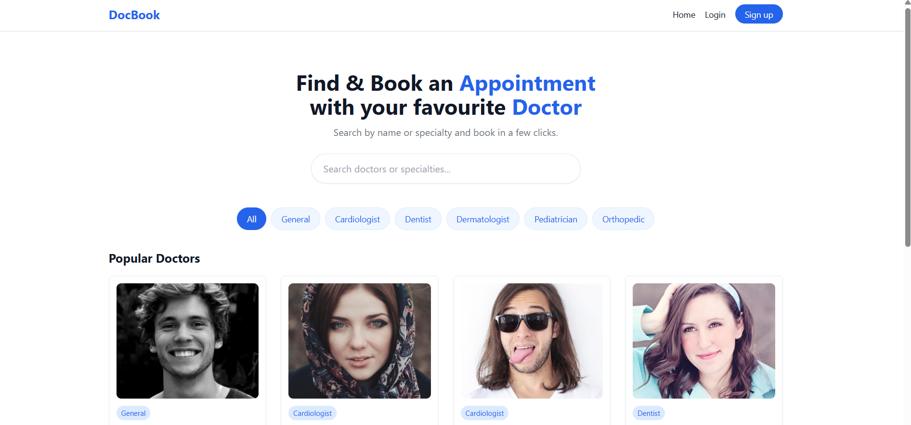
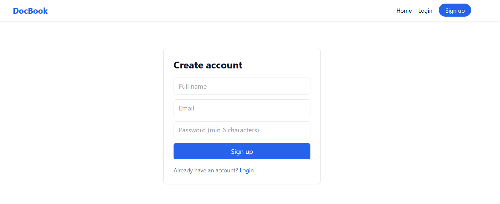
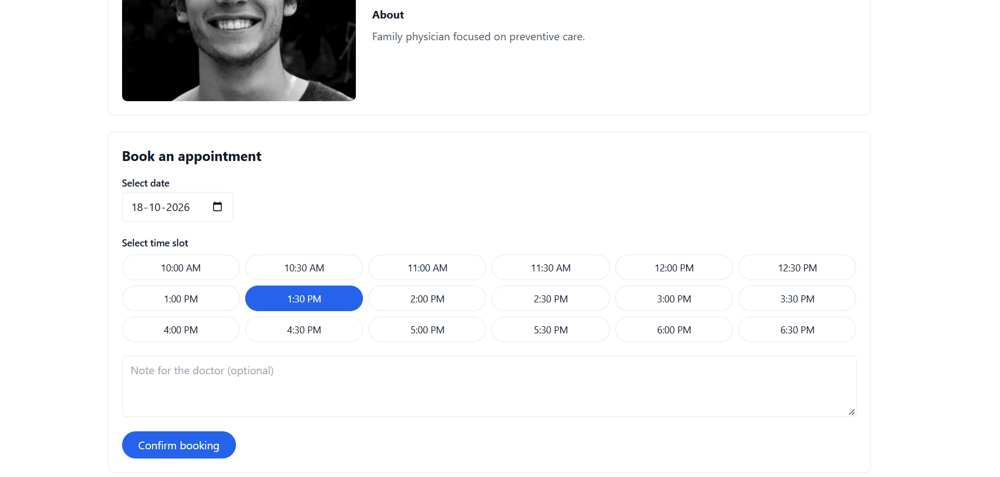
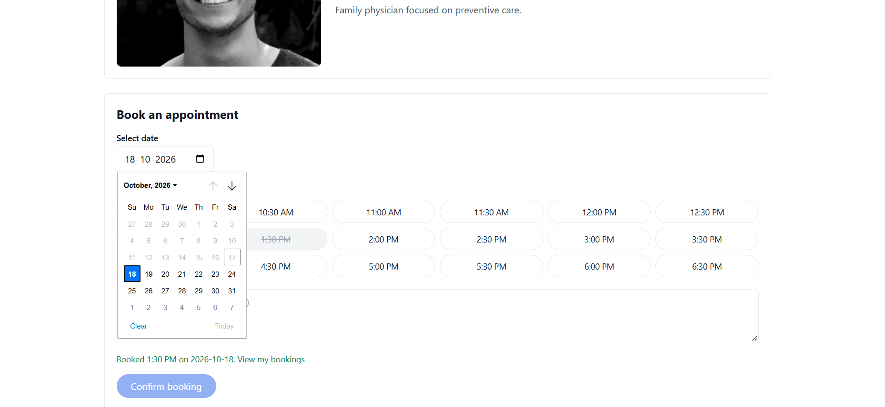
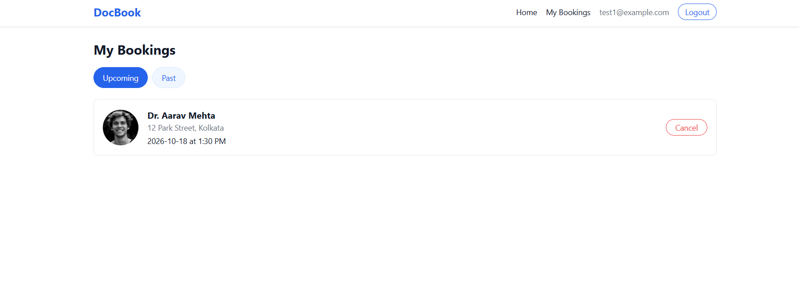

# DocBook - Doctor Appointment Booking

A web app where patients can browse doctors, filter by specialty, and book appointments online.

## Features

- Sign up, log in and log out
- Browse doctors and filter by specialty
- Search doctors by name or specialty
- Doctor details page
- Book an appointment by choosing a date and time slot
- Already-booked slots are disabled, and double-booking is blocked at the database level
- My Bookings page with upcoming and past appointments
- Cancel upcoming appointments

## Tech Stack

- **Frontend:** Next.js 14 (App Router), React, Tailwind CSS
- **Backend and database:** Supabase (PostgreSQL)
- **Authentication:** Supabase Auth (email and password)

## Getting Started

### 1. Clone and install

```bash
git clone
cd doctor-booking
npm install
```

### 2. Set up the database

1. Create a project at [supabase.com](https://supabase.com).
2. Open the **SQL Editor**, paste the contents of `schema.sql`, and run it. This creates the tables, access rules and sample data.
3. For local testing, turn off **Confirm email** under Authentication → Sign In / Providers → Email.

### 3. Add environment variables

Create a `.env.local` file in the project root:

```
NEXT_PUBLIC_SUPABASE_URL=your-project-url
NEXT_PUBLIC_SUPABASE_PUBLISHABLE_KEY=your-publishable-key
```

Both values are in Supabase under Project Settings → API Keys.

### 4. Run the app

```bash
npm run dev
```

Open [http://localhost:3000](http://localhost:3000).

## Database

| Table | Purpose |
|---|---|
| `categories` | Medical specialties |
| `doctors` | Doctor profiles, linked to a category |
| `appointments` | Bookings, linked to a user and a doctor |

A unique constraint on `(doctor_id, date, time_slot)` prevents two people booking the same slot. Row Level Security ensures users can only see and cancel their own appointments.

## Project Structure

```
app/
  page.js               Home: search, categories, doctor list
  login/, signup/       Authentication pages
  doctors/[id]/         Doctor details and booking
  my-bookings/          User's appointments
components/             Header and auth form
lib/supabase.js         Supabase client
```

## Notes

- Doctor names, bios and photos are dummy data for demonstration.
- Email confirmation is disabled for easier testing. Enable it for real use.

## Screenshots





